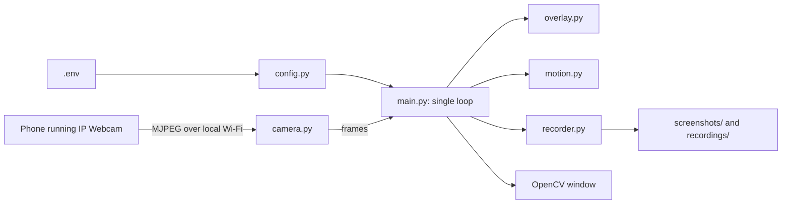

# Architecture

The viewer is one process with one loop and seven Python files. The stream path stays short: a phone sends MJPEG, `camera.py` opens it, and `main.py` turns each frame into a displayed image and, sometimes, a saved file. Nine accepted ADRs in [docs/adr/](../adr/) record the choices that are not obvious from the code. This page explains why the parts fit together this way. The exact names and signatures are in [module-map.md](../reference/module-map.md).

## Layout

## Why one loop

The program handles one camera and reads one frame at a time. A single loop makes the order of operations visible in one place. Keys come from `waitKey(1)` at the end of each iteration, so input and drawing share the same clock. There are no threads and no queues. That keeps the code short and the failure paths predictable.

Ten cameras would break this design. A slow `read()` on one stream would block every other stream, and the CPU cost of decode, resize and draw would add up. A redesign would give each camera a reader thread, keep only the latest frame per camera in a queue, and tile the frames at low resolution on one window. The single-threaded loop is a deliberate fit for one camera, not a general streaming server.

## Why the helpers are leaves

`config.py`, `camera.py`, `overlay.py`, `recorder.py` and `motion.py` import nothing from each other. Only `main.py` imports them. Each helper can be tested without starting a window or a network connection, which is what the nine unit tests do. `main.py` reads like a sequence of steps because the details live behind small function names.

The resize and FPS math stays in `overlay.py` rather than in a package. A marker can read the scale factor and the moving average directly. That is [ADR-0006](../adr/0006-write-resize-and-fps-helpers.md). Motion detection and auto-record share one loop and one `Recorder`, so two bonus features come from one code path, as [ADR-0007](../adr/0007-share-the-motion-path.md) records.

## Why the address is probed first

OpenCV can block for a long time on a wrong IP address on the local subnet. It does not fail fast. `check_reachable` calls `requests.get` with `stream=True` and `REQUEST_TIMEOUT` seconds before OpenCV sees the address. A bad address then produces a one-line message within about five seconds. The probe reads only the start of the MJPEG response; it never downloads the endless stream. RTSP addresses skip the probe because Requests cannot test them. See [ADR-0002](../adr/0002-probe-before-opencv.md).

The real address stays in `.env`. `.env.example` holds only `https://<phone-ip>:8080/video`. `config.py` is the single place that reads the values. This split is [ADR-0001](../adr/0001-keep-camera-secrets-out-of-git.md).

## Why the retry is bounded

A dropped Wi-Fi link often fails one read and recovers on the next. A dead camera fails every read forever. The loop tolerates `MAX_FAILED_READS` consecutive failures, which is 10, before it declares the stream dead. `reconnect` then tries at most `MAX_RECONNECTS` times, which is 5, with `RECONNECT_DELAY` seconds between attempts, which is 2. A successful read resets the failed-read counter to zero. Esc cancels a wait and shuts the program down.

Ten reads and five attempts give roughly ten to fifteen seconds of patience. A brief glitch passes without a visible break. A dead camera ends with one message and exit code 1 instead of a frozen window. That trade-off is [ADR-0003](../adr/0003-bound-the-reconnect.md).

## Why the finally block exists

Every exit path reaches the same cleanup code. `recorder.stop()` releases the `VideoWriter`, which writes the MP4 header and index. `cap.release()` frees the network connection so the phone app has no stuck client. `cv2.destroyAllWindows()` closes the window. The order matters: the writer is finalized before the capture is released.

This applies to Esc, `Ctrl+C`, the window close button, a `CameraError`, and an unexpected exception. Without it, an interrupted recording can leave an unplayable file and a camera that refuses a new client.

## Failure paths

A `CameraError` prints `Error: {message}` to standard error and sets exit code 1. `KeyboardInterrupt` prints `Interrupted, shutting down.` and leaves exit code 0. Any other exception writes a traceback to `app.log` at error level and prints `Unexpected error, see app.log`; exit code is 1. The user never sees a traceback in the terminal. A failed read below the limit is not an error; the loop waits 1 millisecond and reads again.

The TLS default is `CAMERA_VERIFY_SSL=false` because IP Webcam uses a self-signed certificate. Requests skips verification and FFmpeg receives `tls_verify;0`. The trade-off is explained in [ADR-0005](../adr/0005-handle-the-self-signed-certificate.md).

## Why reference and explanation are separate

The documentation follows the Divio four-part layout from [ADR-0009](../adr/0009-use-the-divio-four-part-layout.md). This page explains reasons. [reference/](../reference/) holds facts and tables. Tutorials and how-to guides answer other questions and do not sit inside either section.
