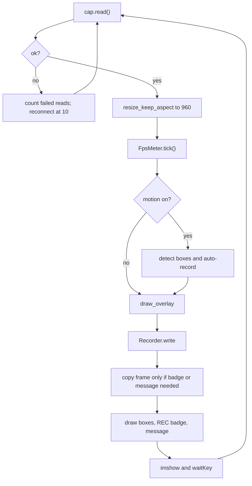

# Video pipeline

Every loop iteration works on one frame. The order is fixed, and the order decides what ends up in a saved file. This page explains each stage and why it sits where it does. Function names and defaults are listed in [module-map.md](../reference/module-map.md) and [configuration.md](../reference/configuration.md).

## Frame path

## Read and failure handling

`cap.read()` returns a success flag and a frame. A good read resets `failed_reads` to zero. A failed read increments it. While the count is below 10, the loop waits 1 millisecond with `waitKey(1)` and tries again. At 10, any active recording is stopped, `Reconnecting...` is drawn on the last displayed frame, and `reconnect` releases the old capture and tries to open a new one. This absorbs a short Wi-Fi glitch without a visible failure. A dead camera reaches the attempt limit and exits cleanly.

## Resize

`resize_keep_aspect` scales the frame to `DISPLAY_WIDTH`, which is 960. The scale is `960 / original width`. The new height is `original height * scale`, rounded down to an even number by `int(h * scale) // 2 * 2`. Even heights suit video codecs. `cv2.resize` uses `INTER_AREA`, which suits downscaling. When the frame is already 960 pixels wide, the function returns the same array without work.

Detection runs on this resized frame, not the original. A smaller frame means fewer pixels to blur, threshold and scan, which protects the frame rate.

## FPS estimate

`FpsMeter.tick` reads `time.perf_counter()`. The first call has no previous time, so it returns `0.0`. Later calls compute `1 / (now - previous)` and smooth it with `fps = 0.1 * instant + 0.9 * fps`. Raw frame gaps vary with network delivery and CPU load, so the number would jump each frame. The smoothing makes it readable.

## Motion stage

When `M` is on, `MotionDetector.detect` converts the frame to grayscale with `COLOR_BGR2GRAY`, blurs it with a `21x21` Gaussian kernel, and takes the absolute difference from the previous blurred frame. A threshold of 25 and two dilation passes produce a binary mask. `findContours` with `RETR_EXTERNAL` and `CHAIN_APPROX_SIMPLE` finds regions; only contours with area of at least `800` become `(x, y, w, h)` boxes.

The loop counts consecutive frames with boxes. Three hits start a recording through the existing `Recorder`. No boxes reset the count. A motion recording stops 5.0 seconds after the last frame with boxes. A recording started with `R` is never stopped by motion. One writer serves both paths. See [ADR-0007](../adr/0007-share-the-motion-path.md).

## Overlay and media write

`process_frame` draws the four labels first: timestamp at `(10, 25)`, camera name at `(10, 50)`, resolution at `(10, h - 35)`, and FPS at `(10, h - 10)`. `put_label` draws white text on a dark box so it reads on any scene.

The frame is then written to the recorder before any status decoration is added. Saved media therefore carries the timestamp, name, resolution and FPS, but no REC badge and no status message. The screenshot called from `handle_keys` uses this same frame, so it is clean too.

Only when a recording is active, a status message is live, or motion detection is on does `process_frame` call `frame.copy()`. Green rectangles, the red REC circle at `(display width - 120, 25)`, the `REC {elapsed}s` text and messages are drawn on that copy. The common frame path makes no copy. That is the cost choice in [ADR-0004](../adr/0004-write-media-before-status-drawing.md).

## Display and keys

`cv2.imshow` shows the prepared image, which is stored as `last_display` for the reconnect notice. `getWindowProperty` checks whether the window is still visible; a closed window breaks the loop. `waitKey(1)` then reads one key and gives OpenCV time to redraw. `handle_keys` applies `Esc`, `S`, `R` or `M`. The window and the media files come from the same frame, so what the user sees and what is saved differ only by the status decoration.

## File naming

`timestamped_path` builds names with a millisecond stamp from `%Y%m%d_%H%M%S_%f` with the last three digits kept. A numeric suffix is added while the path exists, so no file is overwritten. Screenshots are `shot_{milliseconds}.jpg`; recordings are `rec_{milliseconds}.mp4`. See [ADR-0008](../adr/0008-name-media-with-milliseconds.md).
